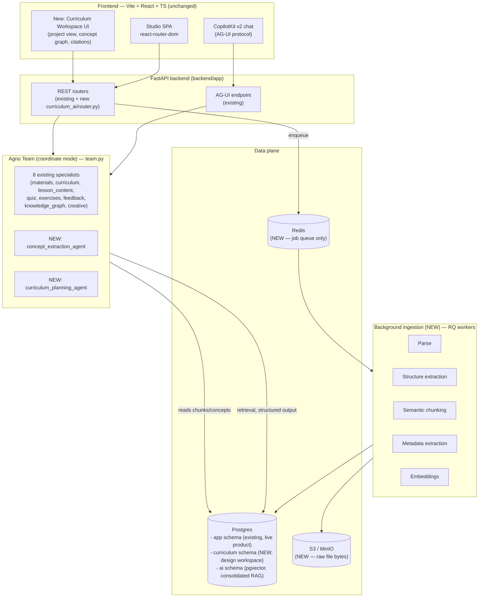
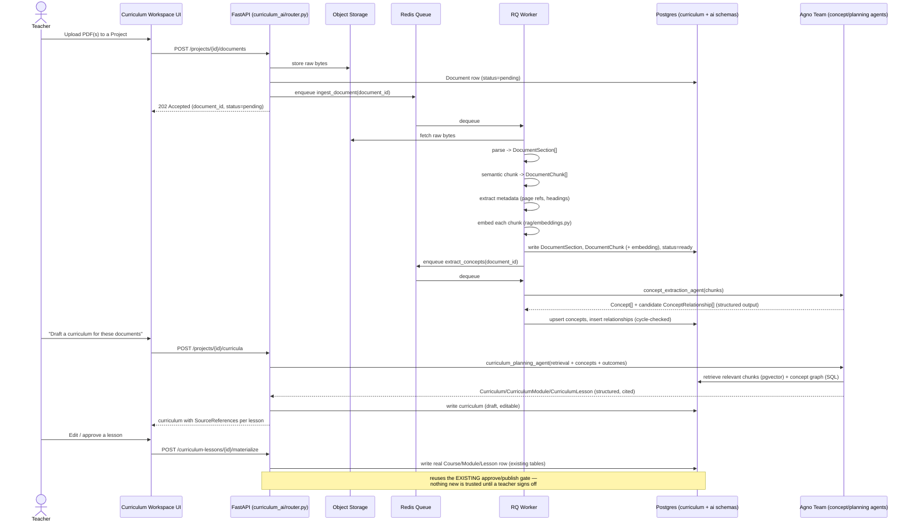
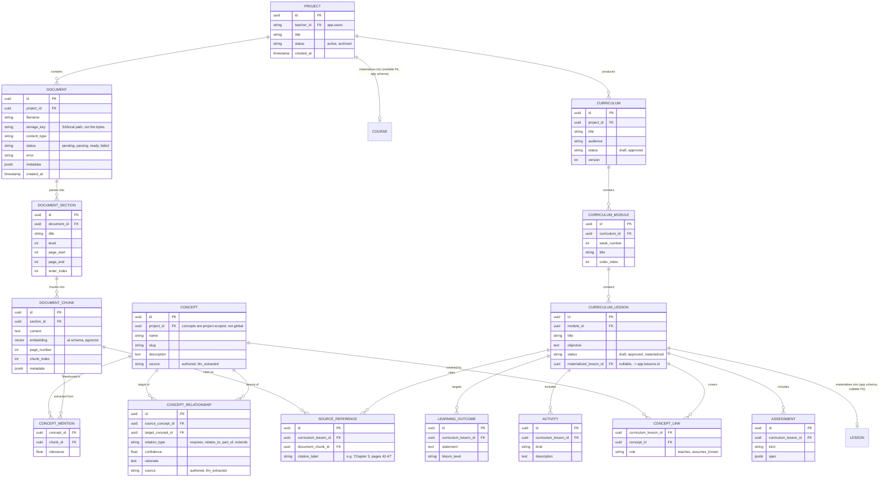
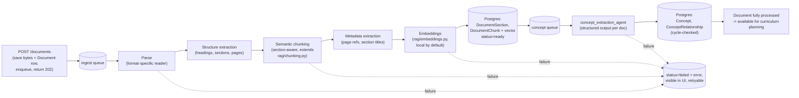
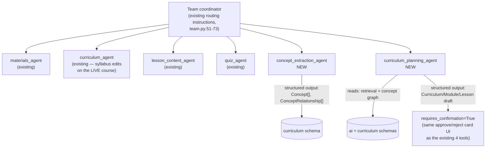
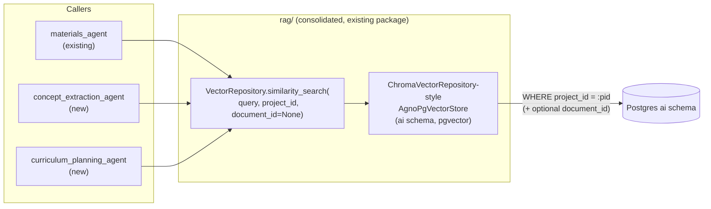

# Educa AI Architecture — Curriculum Design Platform

Status: **Phase 1 implemented** (`backend/curriculum_ai/`), phases 2–12 specified but not yet built. This document analyzes the current repo and proposes a target architecture for turning uploaded documents into a structured, evidence-grounded, editable curriculum, in a 12-phase incremental path. See [Proposed File Manifest](#proposed-file-manifest-phase-1) below for exactly what Phase 1 touched, and [phase-specs.md](phase-specs.md) for the exact, project-owner-specified requirements for every phase (verbatim, not paraphrased) — read that before starting any phase 2+ work.

There is no committed ARCH-01/SRS in this repo — those are external Claude Artifacts (`docs/ARTIFACTS.md`). `docs/README.md` documents today's actual architecture (a two-service prototype: React ↔ AG-UI ↔ FastAPI/Agno ↔ Gemini) and explicitly records that a separate Node Copilot Runtime and a LangGraph layer were both tried and rejected. This document treats that as a standing decision, not something to relitigate.

---

## 1. Current State

### 1.1 What exists today

| Layer           | Reality                                                                                                                                                                                                                 | Where                                                  |
| --------------- | ----------------------------------------------------------------------------------------------------------------------------------------------------------------------------------------------------------------------- | ------------------------------------------------------ |
| Frontend        | **Vite + React 18 + TypeScript**, not Next.js — react-router-dom v6, CopilotKit v2 (AG-UI protocol) for the agent chat, Liveblocks + @xyflow/react for the existing collaborative Knowledge Graph boards         | `frontend/`                                          |
| Backend         | FastAPI, sync SQLAlchemy                                                                                                                                                                                                | `backend/app/`                                       |
| Agents          | Agno`Team` (coordinate mode), 8 specialist packages, each `agents/<name>/{agent.py,tools.py}`                                                                                                                       | `backend/app/agents/team.py`                         |
| Relational DB   | Postgres via SQLAlchemy —`User, Course, Module, Lesson, Enrollment, Quiz, QuizItem, LessonExercise, CreativeAsset, TeacherPersona, TeachingAssistant, QuizAttempt, Response, KnowledgeGraphBoard, Listing, Purchase` | `backend/app/models_db.py`, `backend/app/store.py` |
| Vector DB       | **Already Postgres/pgvector** via Agno's `PgVector` (schema `ai`) — no separate vector DB                                                                                                                    | `backend/rag/store.py`, `backend/app/knowledge.py` |
| File storage    | Local disk (`tmp/rag_uploads/`, `tmp/creative_uploads/`)                                                                                                                                                            | —                                                     |
| Background jobs | **None exist** — ingestion runs synchronously inline in the request handler                                                                                                                                      | —                                                     |
| Model provider  | Agno's own multi-provider`Model` abstraction, defaulting to Gemini (`EDUCA_MODEL`), Anthropic documented as a swap-back option                                                                                      | `backend/app/agents/models.py`                       |
| Auth            | JWT (PyJWT), email/password,`teacher`/`student` roles, `require_role()` dependency                                                                                                                                | `backend/app/auth/`                                  |

`mobile/` (Flutter) and `website/` (Vite/React marketing site) have no overlap with document upload or curriculum generation — out of scope here.

### 1.2 What's directly reusable

This is the single most important finding: **most of the infrastructure this proposal needs already exists**, just not yet pointed at documents-to-curriculum.

- **Postgres + pgvector** is already the vector store (principle #9 — already satisfied, nothing to add).
- **The multi-agent Team pattern** (`team.py`, coordinate mode, one `agents/<name>/` package per concern) is exactly principle #14/#15 ("avoid one giant agent, prefer explicit tools/smaller workflows") already in production. New capability should be new *members* of this team, not a new framework.
- **The human-in-the-loop approval pattern** — every mutating tool (`create_syllabus`, `update_syllabus`, `generate_lesson_slides`, `generate_lesson_quiz`) is `@tool(requires_confirmation=True)`, rendered as approve/reject cards (`frontend/src/components/ApprovalCards.tsx`), sitting on top of a server-enforced publish gate the agent cannot bypass (`POST /api/lessons/{id}/publish`). Curriculum generation should plug into this same pattern, not invent a new one.
- **A provider-swappable embedder** already exists (`backend/rag/embeddings.py`, built and tested this session) — local `sentence-transformers` by default, OpenAI/Gemini as drop-in alternatives.
- **The exact prerequisite-graph algorithm this proposal needs was already built and tested this session**, as a standalone prototype: `ai-lab/curriculum_knowledge_engine/` — Postgres-backed concepts + typed `PrerequisiteEdge`s (`requires/relates_to/part_of/extends`), cycle detection, topological-sort learning paths, LLM-extracted edges kept separate from and subordinate to authored ones. That prototype's `repositories/graph/networkx_repository.py` algorithms (67 passing tests) are the reference design for §6.4's `concept_relationships` table — port the algorithm, not the in-memory backend.
- **The tenant-scoping pattern** in `rag/store.py` (`similarity_search(..., course_id=...)`, filters baked into every query) is the right shape for retrieval boundaries — see §1.3's finding on `app/knowledge.py` for the counter-example.

### 1.3 Architectural problems relevant to this project

1. **Two parallel, duplicate RAG stacks.** `backend/rag/` (newer, tenant-scoped, has a REST API) and `backend/app/knowledge.py` (older, powers `materials_agent` and Studio's "Upload material" button) both wrap Agno's `PgVector` independently, with separate tables (`ai.rag_chunks` vs `ai.course_materials`) and separate chunking logic. Building concept extraction and retrieval on top of *both* doubles the surface area for no benefit. **This needs consolidating before Phase 6** (concept extraction), not after.
2. **`app/knowledge.py` has no tenant boundary at all.** `add_material` / `list_materials` / `delete_material` take no `organization_id`/`course_id` — every teacher's uploaded materials are searchable by every other teacher's `materials_agent` today. This directly violates principle #6 ("retrieval must enforce user/project/document boundaries") and is a real, currently-shipped gap, not a hypothetical one. `rag/store.py`'s tenant filtering is the pattern to standardize on.
3. **No background processing exists anywhere.** Every upload (`POST /api/materials`, `POST /api/rag/documents`) parses, chunks, and embeds *inline in the request*, synchronously. A multi-page PDF already takes several seconds; a real ingestion pipeline (parse → structure → chunk → metadata → embed → concept-extract) run inline would make uploads time out and gives no retry/observability story. Principle #4 is not yet satisfied.
4. **No object storage.** Uploaded bytes live on local disk under `tmp/`. This doesn't survive a redeploy, doesn't scale past one instance, and isn't what principle "Storage: S3-compatible object storage" asks for.
5. **`Course`/`Module`/`Lesson` are the live, published-product schema** — they carry `approved`/`published` flags and are the trust boundary the whole approve-gate UI is built around (see §1.2). The new `Project`/`Curriculum`/`Concept`/... entities this proposal introduces **must not** be bolted onto these tables directly; they need their own schema with an explicit "materialize" step into the existing tables (see §6).
6. **No eval harness anywhere in the repo.** `backend/pytest.ini` has `unit`/`integration` markers and real integration tests against local Postgres (`backend/tests/integration/test_rag_store.py`, written this session), but nothing measures retrieval quality, parsing/structure-extraction accuracy, or generated-curriculum quality. Principle #13 is greenfield.

---

## 2. Target Architecture



**Deliberately not introduced:** Kubernetes, Kafka, Neo4j, Pinecone/a dedicated vector DB, Elasticsearch, a separate microservice per pipeline stage, a second web framework. Concepts and prerequisites are plain Postgres tables (principle #8); background work is one Redis-backed worker pool, not a stream platform; retrieval stays on pgvector (principle #9, already true today).

---

## 3. Proposed Folder Structure

Additive, not a rewrite — new code lives beside, not instead of, what's there.

```
backend/
  app/                          # unchanged: live product (courses, lessons, auth, agents)
  rag/                          # existing standalone RAG package — becomes the ONE
                                 # retrieval implementation (see §1.3 finding #1);
                                 # app/knowledge.py's callers migrate to it, then it's deleted
  curriculum_ai/                # NEW package — the design-workspace pipeline
    __init__.py
    models.py                   # SQLAlchemy models, schema="curriculum" (§6)
    schemas.py                  # Pydantic DTOs (API + structured-output contracts)
    storage/
      base.py                   # ObjectStorage protocol
      local.py                  # dev default, mirrors today's tmp/ pattern
      s3.py                     # boto3, MinIO-compatible
    ingestion/
      parsers/                  # format-specific: pdf, (future: docx, pptx)
      structure.py               # heading/section/page structure extraction
      chunker.py                 # semantic chunking (extends rag/chunking.py's approach)
      metadata.py                 # per-chunk metadata extraction
      pipeline.py                 # orchestrates parse→structure→chunk→metadata→embed
    jobs/
      queue.py                    # RQ connection + enqueue helpers
      tasks.py                    # the actual background task functions
      worker.py                   # `python -m curriculum_ai.jobs.worker` entrypoint
    concepts/
      extraction.py                # concept_extraction_agent tool implementation
      relationships.py             # prerequisite-graph read/write + cycle detection
                                    # (port of ai-lab/curriculum_knowledge_engine's
                                    # networkx_repository.py algorithm onto Postgres)
    planning/
      generator.py                  # curriculum_planning_agent tool implementation
      materialize.py                 # Curriculum/CurriculumModule/CurriculumLesson
                                      # -> live Course/Module/Lesson, reusing the
                                      # existing approve/publish gate
    router.py                        # REST: projects, documents, curricula, concepts
  tests/
    unit/curriculum_ai/                # fast, no services (chunking, graph algorithm)
    integration/curriculum_ai/         # real Postgres + Redis, fake LLM client
    evals/                             # NEW — see §10

frontend/src/
  curriculum-workspace/                # NEW route: project view
    ProjectPage.tsx
    DocumentUploadPanel.tsx
    ConceptGraphView.tsx                # reuses @xyflow/react (already a dependency)
    CurriculumEditor.tsx
    SourceCitation.tsx                   # renders "Chapter 3, pages 42-47" style refs

docs/architecture/
  educa-ai-architecture.md               # this document
```

---

## 4. Data Flow: Upload → Curriculum



---

## 5. Database Design

Two schemas in the **same** Postgres instance (principle #9 already satisfied — no new database engine):

- `app` (implicit/default — unchanged): `users, courses, modules, lessons, enrollments, quizzes, ...` — the live, published product.
- `ai` (existing, consolidated per §1.3 finding #1): one chunk table, replacing today's `ai.rag_chunks` + `ai.course_materials` split.
- `curriculum` (**new**): the AI design workspace — everything below.



**Why a separate schema instead of extending `app.models_db`:** `Course`/`Module`/`Lesson` are the trust boundary the publish-gate UI is built on (§1.3 #5). `CurriculumLesson` is a *draft* — editable, regenerable, version-able, not yet trusted. `materialized_lesson_id` is the one bridge: set exactly when a teacher approves a curriculum lesson, at which point a real `app.lessons` row is created through the **existing** service layer (`app/store.py`), so publish semantics don't change at all.

**Why `Concept`/`ConceptRelationship` are project-scoped, not global:** matches principle #8 exactly, and mirrors the validated design in `ai-lab/curriculum_knowledge_engine/src/cke/repositories/graph/networkx_repository.py` — `relation_type=requires` edges are cycle-checked on write (reject, don't silently corrupt); `relates_to/part_of/extends` are not (associative, not load-bearing for ordering). A global concept space across every teacher's unrelated projects would conflate "Voltage" in an electrical-circuits course with an unrelated homonym in a different project — scoping to `project_id` avoids that with no loss of capability at this stage; cross-project concept reuse is a later, opt-in feature if it's ever needed.

---

## 6. Backend Modules

| Module                       | Responsibility                                                                                                                                                                                                                                                                            | Talks to                                                  |
| ---------------------------- | ----------------------------------------------------------------------------------------------------------------------------------------------------------------------------------------------------------------------------------------------------------------------------------------- | --------------------------------------------------------- |
| `curriculum_ai/storage/`   | `ObjectStorage` protocol (`put`, `get`, `delete`, `url_for`); `LocalDiskStorage` (dev default) and `S3Storage` (boto3, MinIO/AWS) implementations — same swappable-provider shape as `rag/embeddings.py`'s `build_embedder()`                                          | S3/MinIO or local disk                                    |
| `curriculum_ai/ingestion/` | Pure functions: bytes →`ParsedDocument` → `DocumentSection[]` → `DocumentChunk[]` (+ metadata). No FastAPI, no DB — same separation-of-concerns as `rag/parsers.py`/`rag/chunking.py` already model                                                                         | called by`jobs/tasks.py`, not the API directly          |
| `curriculum_ai/jobs/`      | RQ queue + task functions; each task is a thin wrapper calling`ingestion/pipeline.py` then writing via `models.py`                                                                                                                                                                    | Redis, Postgres                                           |
| `curriculum_ai/concepts/`  | `extraction.py` — the tool `concept_extraction_agent` calls, structured-output extraction per document; `relationships.py` — graph read/write, cycle detection, prerequisite-chain queries (ported algorithm)                                                                     | Postgres, Agno agent                                      |
| `curriculum_ai/planning/`  | `generator.py` — the tool `curriculum_planning_agent` calls: retrieval + concept graph in, structured `Curriculum` draft out; `materialize.py` — draft → live `Course`/`Module`/`Lesson` via `app/store.py`'s existing functions                                       | Postgres (both schemas),`rag/`, Agno agent              |
| `curriculum_ai/router.py`  | REST:`POST /projects`, `POST /projects/{id}/documents`, `GET /documents/{id}` (status polling), `POST /projects/{id}/curricula`, `PATCH /curriculum-lessons/{id}`, `POST /curriculum-lessons/{id}/materialize` — mirrors `rag/router.py`'s existing auth/ownership pattern | `app/auth`, `app/store` (for course ownership checks) |
| `rag/` (consolidated)      | The one retrieval implementation —`app/knowledge.py`'s callers (`materials_agent`, Studio's upload button) migrate to it; `app/knowledge.py` is deleted once migrated                                                                                                              | Postgres`ai` schema                                     |

---

## 7. Background Processing Pipeline



**Queue technology: RQ (Redis Queue), not Celery.** The existing codebase is synchronous top to bottom (sync SQLAlchemy sessions, sync `sentence-transformers` calls, sync Agno tool functions) — RQ's plain-function, synchronous-worker model ports the existing `rag/ingestion` code into a background task with zero rewrite. Celery would work too but its broker/backend/routing configuration is more machinery than this needs right now; `arq` (async-native) would require adopting async SQLAlchemy across the codebase first. If the team later goes all-in on async FastAPI, revisit — not before.

**Each stage is a plain Python function, independently testable** (principle #12) — `ingestion/pipeline.py`'s functions take bytes/`ParsedDocument` in and typed dataclasses out, no Redis or Postgres required to unit-test them, exactly like `rag/chunking.py`'s `SectionChunker` is tested today (`backend/tests/test_rag.py`).

---

## 8. AI / Copilot Architecture

**Two new members join the existing `team.py` Team — no new agent framework, no new orchestration layer:**



- **Structured output, not free text.** Every new tool returns a typed Pydantic model (mirroring `frontend/src/components/ApprovalCards.tsx`'s existing `SyllabusArgs`/`LessonSlidesArgs` pattern, which already assumes typed tool args on the backend). `concept_extraction_agent` returns `ConceptExtractionResult{concepts, relationships}`; `curriculum_planning_agent` returns `CurriculumDraft{modules: [...]}`, each lesson carrying `source_references` inline — the model is required to cite, not just narrate.
- **Untrusted content boundary (principle #5).** Retrieved chunk text is uploaded-document content, not an instruction. Every prompt that injects retrieved chunks wraps them in an explicit delimiter (e.g. `<retrieved_chunk source="...">...</retrieved_chunk>`) with a system instruction that content inside those tags is data to cite or ignore, never a command to follow — the same treat-tool-results-as-data discipline already used for this session's own tool outputs.
- **Provider abstraction: already exists, reuse it.** `agents/models.py`'s `build_model()`/`build_fallback_models()` is Agno's own multi-provider abstraction (Gemini default, Anthropic documented swap-in). The new agents call the same builder — no new abstraction to write.
- **Human-in-the-loop stays the trust boundary.** `curriculum_planning_agent`'s draft is never auto-published; it lands as an editable `CurriculumLesson` row, and only an explicit teacher action (`materialize`) ever touches the live `Course`/`Module`/`Lesson` tables — identical in spirit to today's approve/reject cards, just one step earlier in the pipeline (design draft → live course, instead of syllabus edit → live course).

---

## 9. RAG / Retrieval Architecture

RAG is the **evidence subsystem** two layers call into — it is not the application (principle #1/#2):



- **One retrieval implementation**, not two (§1.3 finding #1) — `app/knowledge.py` is retired, its callers point at `rag/`.
- **Boundary enforcement is structural, not optional.** Every `similarity_search` call takes `project_id` (renaming today's `organization_id`/`course_id` params to match the new `Project` entity) and filters in the query itself, the same pattern `rag/store.py` already implements — never an app-layer post-filter a caller could forget to apply.
- **Hybrid search stays** (`SearchType.hybrid`, already in use) — vector similarity blended with Postgres full-text, unchanged.
- **Chunk-level citations are what make `SourceReference` possible.** Because chunks already carry `section_id`/`page_number`/`document_id` (§5), "Chapter 3, pages 42-47" is a direct read off the chunks a generation step actually used — not a separate bolt-on citation system.

---

## 10. Evaluation / Testing Architecture

Three eval surfaces, each versioned fixtures + a runnable script under `backend/tests/evals/`, using the `unit`/`integration` marker convention already in `backend/pytest.ini`:

1. **Retrieval quality** — a fixed set of (query, expected chunk ids) pairs per a labeled sample document; scores precision@k/recall@k. Cheap, deterministic, no LLM call — run on every PR.
2. **Document understanding** — a handful of hand-labeled sample PDFs (structure: expected sections/headings/page ranges) checked against `ingestion/structure.py`'s output. Catches parser regressions before they silently corrupt downstream chunking.
3. **Curriculum quality** — LLM-as-judge scoring a generated `CurriculumDraft` against a rubric (concept coverage, prerequisite-order correctness — checked *programmatically* via the same cycle/topological-sort logic as `concepts/relationships.py`, not just by the judge — plus citation groundedness: does every `SourceReference` actually point at a chunk that supports the claim). Judge calls cost money — run on-demand and in CI nightly, not on every commit.

**Testability by construction (principle #12):** every AI-calling module accepts an injected client (mirroring this session's `FakeClaudeClient`/`StubVectorRepository` test doubles in `ai-lab/curriculum_knowledge_engine/tests/conftest.py`), so unit tests for prompt-building, structured-output parsing, and the graph algorithm run with zero network calls; integration tests run the same code against real local Postgres + Redis (mirroring `backend/tests/integration/test_rag_store.py`, already established this session), with the LLM call still faked — the *pipeline* under test, not Gemini's output quality, which is what the eval suite above measures separately.

---

## 11. Security Boundaries

| Boundary                   | Mechanism                                                                                                                                                                                                                                                                 |
| -------------------------- | ------------------------------------------------------------------------------------------------------------------------------------------------------------------------------------------------------------------------------------------------------------------------- |
| Auth                       | Existing`require_role("teacher")` JWT dependency, unchanged — every `curriculum_ai/router.py` endpoint gated the same way `rag/router.py` already is                                                                                                               |
| Project ownership          | `Project.teacher_id` checked against the authenticated user on every read/write, same `_assert_course_owner`-style check `rag/router.py:30-36` already implements                                                                                                   |
| Retrieval tenancy          | `project_id` filter baked into every vector query (§9) — not app-layer, not optional                                                                                                                                                                                  |
| Untrusted document content | Retrieved chunks are always prompt-delimited as data, never concatenated as instructions (§8); the extraction/planning agents' tool schemas constrain what a response can even contain (structured output = injected text can't smuggle a tool call it wasn't asked for) |
| Materialize step           | The only path from`curriculum` schema into the live `app` schema is the explicit, teacher-triggered `materialize` action — going through `app/store.py`'s existing functions, so every existing check there (course ownership, publish gate) applies unchanged   |
| Object storage             | Signed, time-limited URLs for any direct client access to`S3Storage`; `LocalDiskStorage` (dev) never serves files directly off disk without going through the authenticated API, matching how `rag/router.py` already handles uploads today                         |
| File-type/size limits      | Reuse existing`MAX_UPLOAD_BYTES`-style guard (`app/knowledge.py:32` today) at the API boundary, before enqueueing — reject oversized/wrong-type files before a worker ever touches them                                                                              |

---

## 12. Phased Implementation Plan

Each phase is independently shippable and testable; nothing here is built until you've reviewed this document.

| Phase        | Deliverable                                                                                                                                                                                                    | Depends on |
| ------------ | -------------------------------------------------------------------------------------------------------------------------------------------------------------------------------------------------------------- | ---------- |
| **1**  | `Project`/`Document` tables + `ObjectStorage` (local + S3 impls) + upload endpoint that saves bytes and returns `202` with no processing yet                                                           | —         |
| **2**  | Document parsing (PDF first, reusing`rag/parsers.py`'s pattern) as a plain function, unit-tested on sample PDFs                                                                                              | 1          |
| **3**  | `DocumentSection`/structured document model persisted; parsing wired to write it                                                                                                                             | 2          |
| **4**  | Semantic chunking + metadata + embeddings (`rag/` consolidation happens here — one chunk table, one embedder)                                                                                               | 3          |
| **5**  | Retrieval endpoint + tenant-scoped`similarity_search`; `materials_agent` migrated onto consolidated `rag/`                                                                                               | 4          |
| **6**  | `concept_extraction_agent` (structured output) + `Concept`/`ConceptMention` tables                                                                                                                       | 5          |
| **7**  | `ConceptRelationship` + cycle-checked graph writes + prerequisite-chain queries (port `ai-lab/curriculum_knowledge_engine`'s algorithm)                                                                    | 6          |
| **8**  | `curriculum_planning_agent` — retrieval + concept graph in, `Curriculum`/`CurriculumModule`/`CurriculumLesson` draft out, with `SourceReference`s                                                   | 7          |
| **9**  | Curriculum validation — cycle/coverage checks run automatically on every draft before it's shown as ready for review                                                                                          | 8          |
| **10** | Copilot tools in Studio's chat: "draft a curriculum from these documents," "explain why lesson X requires concept Y" — wired through the existing Team/AG-UI, approve/reject UI extended to curriculum drafts | 8, 9       |
| **11** | Evaluation framework (§10) — retrieval, document-understanding, curriculum-quality suites, running in CI                                                                                                     | 5, 7, 9    |
| **12** | Observability (structured logs on every pipeline stage, job failure alerting) + production hardening (S3 in prod, Redis persistence/retry policy, rate limits on generation endpoints)                         | all        |

Background-processing (RQ + Redis) is introduced in Phase 1, since even Phase 1's upload endpoint should enqueue rather than block — but the *worker* doing real work only starts mattering from Phase 2 onward.

---

## Proposed File Manifest (Phase 1)

Files I'd create or modify to deliver Phase 1 only — **not started**, pending your review of this document.

**Create:**

- `backend/curriculum_ai/__init__.py`
- `backend/curriculum_ai/models.py` — `Project`, `Document` (SQLAlchemy, `schema="curriculum"`)
- `backend/curriculum_ai/schemas.py` — Pydantic request/response DTOs
- `backend/curriculum_ai/storage/base.py` — `ObjectStorage` protocol
- `backend/curriculum_ai/storage/local.py` — dev default
- `backend/curriculum_ai/storage/s3.py` — boto3/MinIO
- `backend/curriculum_ai/jobs/queue.py` — RQ connection + enqueue helper
- `backend/curriculum_ai/router.py` — `POST /projects`, `GET /projects`, `POST /projects/{id}/documents`, `GET /documents/{id}`
- `backend/tests/unit/curriculum_ai/test_storage.py`
- `backend/tests/integration/curriculum_ai/test_router.py`

**Modify:**

- `backend/app/main.py` — mount `curriculum_ai.router`
- `backend/app/db/__init__.py` (or wherever `init_db()` registers model modules) — register `curriculum_ai.models`
- `backend/docker-compose.yml` — add `redis` service
- `backend/requirements.txt` — add `rq`, `boto3`
- `backend/.env.example` — document new storage/Redis env vars

No frontend changes in Phase 1 (nothing to render yet beyond an upload button, and Studio already has one upload pattern to crib from in `RoutinePanel.tsx`) — frontend work starts meaningfully at Phase 5 (showing retrieval/citations) and Phase 8 (the curriculum editor).
