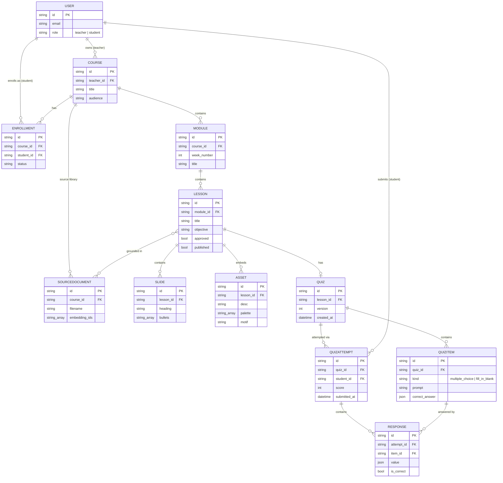

# Educa — entity diagram

Every entity across the product so far, including the assessment entities
proposed for the quiz-consistency problem (`Quiz` / `QuizItem` /
`QuizAttempt` / `Response`) — not yet in `backend/app/store.py`. Rendered
version (same content, styled): [Educa Entity
Diagram](https://claude.ai/code/artifact/25c672f6-42ae-473b-918a-959be1128d8c)
artifact.

- **12** entities total
- **8** already speced or built
- **4** proposed for assessments
- **15** relationships

## Already speced or built

| Entity | Status |
| --- | --- |
| `User` | auth exists on frontend; role concept assumed |
| `Course` | built — single global course in the mini prototype |
| `Module` | speced (ARCH-01) — currently embedded as `Course.weeks[]` |
| `Lesson` | built |
| `Slide` | speced — currently embedded as `Lesson.content.slides[]` |
| `SourceDocument` | speced (SRS module B) — not in the mini prototype backend |
| `Asset` | speced (ARCH-01 §05 / SRS module I) — not built |
| `Enrollment` | speced — not built (no multi-student model yet) |

## Proposed — the assessment fix

| Entity | Note |
| --- | --- |
| `Quiz` | immutable once created; a regenerate makes a new version, not an edit |
| `QuizItem` | discriminated by `kind` — the fixed shape the AI must emit |
| `QuizAttempt` | written once at submission; score is a stored fact, never recomputed |
| `Response` | one row per item per attempt — what makes per-question analytics possible later |

See also: [exam-marking/](../exam-marking/README.md) sketches a further
extension on top of `Quiz`/`QuizItem`/`QuizAttempt`/`Response` — exam
scheduling/timers, paper-scan ingestion, AI marking, and a
submit-to-faculty workflow. Still ideation, not yet reflected in the
diagram above.

## Reading the diagram

`LESSON ||--o| QUIZ` means a lesson has at most one quiz (0 or 1); `QUIZ
||--o{ QUIZATTEMPT` means one quiz has many attempts (one per student,
potentially more if retakes are ever allowed). The `}o--o{` between LESSON
and SOURCEDOCUMENT is the only many-to-many: a lesson can cite several
source documents, and one document can ground several lessons.
