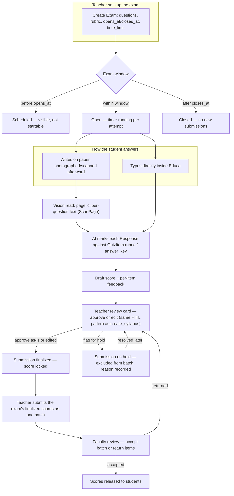

# Exam marking — proposed feature

Still at the thinking-out-loud stage — this sketches the shape of a
feature, not a spec to build from yet. Extends the `Quiz`/`QuizItem`/
`QuizAttempt`/`Response` entities already proposed in [the entity
diagram](../entity-diagram/README.md).

The ask, gathered from conversation: a teacher schedules an exam (with a
timer and an open/close window), a student answers either on paper
(scanned/photographed afterward) or directly inside Educa, the paper
gets scored automatically, the finalized scores get submitted up to the
faculty, and some students' scores can be put on hold instead of going
through with the rest.

## The flow

## Entity changes this implies

| Entity               | Change                                                                                                                          | Why                                                                                                                                                                                                  |
| -------------------- | ------------------------------------------------------------------------------------------------------------------------------- | ---------------------------------------------------------------------------------------------------------------------------------------------------------------------------------------------------- |
| `QUIZ` → `EXAM` | +`opens_at`, `closes_at`, `time_limit_minutes`, `status`                                                                | nothing in the current model tracks when an exam is open or how long a student gets — this is exactly the Moodle quiz-timing settings from the[teacher journey](../moodle/teacher-journey/README.md) |
| `SUBMISSION` (new) | one row per student per exam,`source: paper \| digital`, `status: in_progress → submitted → scored → on_hold / finalized` | wraps either input path so`QUIZATTEMPT` doesn't need to know which one was used; carries the pipeline state, including hold                                                                        |
| `SCANPAGE` (new)   | `submission_id FK, image_url, ocr_text, page_number, scanned_at`                                                              | paper path only — one row per photographed/scanned page;`ocr_text` is what actually gets marked, not the image itself                                                                             |
| `QUIZITEM`         | +`rubric` / `answer_key`                                                                                                    | free-text/essay items need something richer than the current`correct_answer` for the AI to mark against                                                                                            |
| `RESPONSE`         | +`ai_score`, `ai_confidence`, `teacher_score`, `is_final`                                                               | separates the AI's draft mark from the teacher-approved one — same shape as`Lesson.approved`/`published`                                                                                        |
| `GRADEBATCH` (new) | `exam_id FK, submitted_by FK, submitted_at, status: pending \| accepted \| returned`                                            | "submit to faculty" is a batch action across a whole exam's cohort, not a per-student one                                                                                                            |
| `USER.role`        | +`faculty`                                                                                                                    | someone has to be on the other end accepting or returning the batch                                                                                                                                  |

## Notes

- **The AI mark is a draft, not a grade**, until a teacher confirms it —
  identical to how `Lesson.approved`/`published` already works, and to
  the human-in-the-loop pattern on all three agent tools
  ([docs/README.md](../README.md)). Nothing here proposes auto-releasing
  a score without that step.
- **Handwriting OCR accuracy is the real risk** on the paper path, not
  the marking logic itself — a wrong read produces a confidently wrong
  mark. That's the argument for keeping `ai_confidence` on `Response`
  and never letting the review step be skipped or batch-approved blindly
  for scanned submissions.
- **"Submit to faculty" has no real Moodle analogue** — Moodle's
  gradebook is just visible to admins/managers directly, there's no
  submit/accept/return workflow between teacher and institution. This
  piece is Educa's own institutional layer, not something to crib from
  the [Moodle mind map](../moodle/mind-map/README.md).
- **Hold is a status, not a dead end** — a submission on hold (dispute,
  suspected integrity issue, incomplete paper) sits outside the batch
  until someone resolves it back through review; it shouldn't block the
  rest of the cohort's scores from reaching faculty on time.
