# Moodle — feature mind map

The shape of a Moodle site, from site-wide roles down to what a single
quiz attempt is made of.

```mermaid
flowchart TB
    Moodle[Moodle instance]
    Moodle --> Roles
    Moodle --> CourseStructure["Course structure"]
    Moodle --> Enrollment
    Moodle --> Gradebook
    Moodle --> Communication
    Moodle --> Completion["Completion & badges"]
    Moodle --> Reports

    Roles --> Admin["Site admin"]
    Roles --> Manager
    Roles --> CourseCreator["Course creator"]
    Roles --> Teacher["Teacher (editing)"]
    Roles --> NonEditTeacher["Non-editing teacher"]
    Roles --> Student
    Roles --> Guest

    CourseStructure --> Category["Course category"]
    Category --> Course
    Course --> Section["Section / Topic / Week"]
    Section --> Resource["Resources: File, Page, Book, URL, Folder, Label"]
    Section --> Activity["Activities"]
    Activity --> Quiz
    Activity --> Assignment
    Activity --> Forum
    Activity --> Lesson["Lesson (branching content)"]
    Activity --> Workshop["Workshop (peer review)"]
    Activity --> H5P
    Activity --> Choice["Choice / Feedback"]

    Quiz --> QuestionBank["Question bank: MCQ, true/false, matching, short answer, essay, cloze"]
    Quiz --> QuizAttempt["Attempts: grading method, time limit, review options"]

    Enrollment --> Manual["Manual enrollment"]
    Enrollment --> SelfEnrol["Self-enrollment (key)"]
    Enrollment --> CohortSync["Cohort sync"]
    Enrollment --> GuestAccess["Guest access"]

    Gradebook --> GradeCategories["Grade categories & weighting"]
    Gradebook --> GradeItems["Grade items (per activity)"]
    Gradebook --> GradeAggregation["Aggregation: mean, weighted, highest"]

    Communication --> Messaging
    Communication --> ForumDigest["Forum subscriptions/digest"]
    Communication --> Notifications
    Communication --> Calendar

    Completion --> ActivityCompletion["Per-activity completion criteria"]
    Completion --> CourseCompletion["Course completion criteria"]
    Completion --> Badges

    Reports --> Logs
    Reports --> ParticipationReport["Participation report"]
    Reports --> GradesReport["Grade history"]
    Reports --> CompetencyReport["Competency / outcomes"]
```

## Where this maps onto Educa

| Moodle concept                                       | Educa today                                                         | Gap it exposes                                                                                                                |
| ---------------------------------------------------- | ------------------------------------------------------------------- | ----------------------------------------------------------------------------------------------------------------------------- |
| Course → Section → Activity/Resource               | `Course` → `Module` → `Lesson`/`Slide` — already modeled | none — this part of the diagram already matches                                                                              |
| Question bank → Quiz → Attempt                     | Proposed`Quiz`/`QuizItem`/`QuizAttempt`/`Response`          | close match; Moodle reuses one question bank across many quizzes, Educa's`QuizItem` is currently owned by a single `Quiz` |
| Enrollment methods (manual, self-enrol, cohort sync) | `Enrollment.status` only                                          | Educa has no*method* — no self-enrol flow, no bulk/cohort add                                                              |
| Gradebook (categories, weighted aggregation)         | nothing                                                             | `QuizAttempt.score` is per-quiz; there's no course-level rollup across multiple quizzes/assignments                         |
| Activities beyond Quiz (Forum, Assignment, Choice)   | nothing                                                             | Educa only generates read content + one assessment type; no discussion or free-response submission activity                   |
| Completion & badges                                  | `Lesson.published` (teacher-side gate)                            | nothing student-facing — no per-lesson completion tracking or course-completion criteria                                     |

The first row is the reassuring one: Educa's core content hierarchy
already lines up with a real LMS. The gaps (gradebook rollup, enrollment
methods, completion tracking) are the concrete "what's still missing to
be a normal platform" list — not things to build now, just what Moodle
makes visible.
