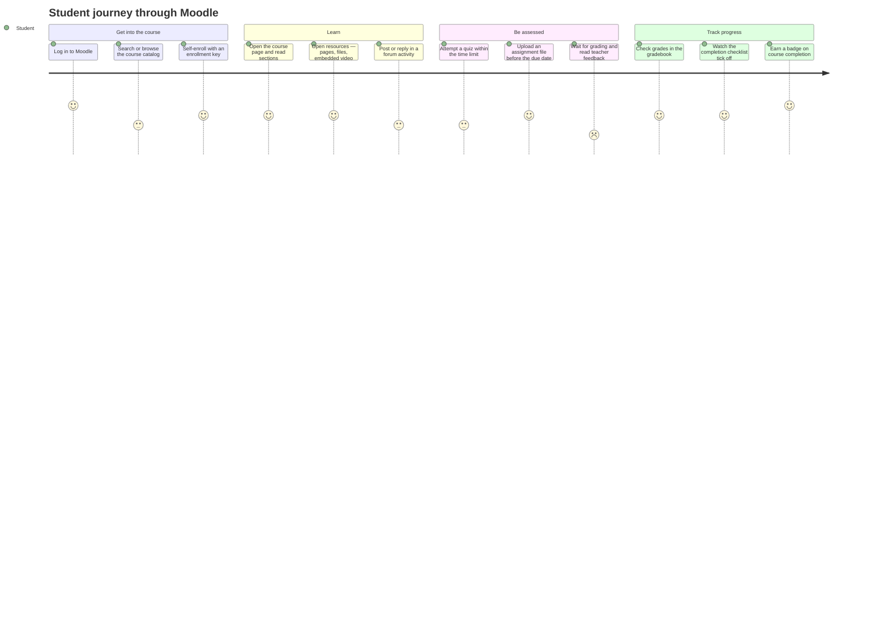

# Student journey through Moodle

Enrollment to badges. Same scoring convention as the [teacher
journey](../teacher-journey/README.md): 1–5 happiness at that step.

## Reading the low point

- **Waiting for grading (2):** quizzes self-grade instantly, but
  assignments and essay-type quiz questions sit in a teacher's queue —
  the single biggest source of "when will I know my grade" friction in
  Moodle. Educa doesn't have this problem yet only because it doesn't
  have free-response grading at all: `QuizItem.kind` is
  `multiple_choice | fill_in_blank`, both auto-gradable. The moment
  Educa adds an open-ended question type, it inherits this exact wait.
- **Course catalog search (3):** finding the right course among many is
  a real Moodle weak spot (categories nest deep, search is keyword-only).
  Doesn't apply to Educa yet — there's one course, one student list, no
  catalog to browse.

Compare against the [teacher journey](../teacher-journey/README.md): the
student side has no analogue to Moodle's question-bank pain, but it's the
side that inherits the grading-wait cost the moment Educa's assessment
model grows past auto-gradable question types.
