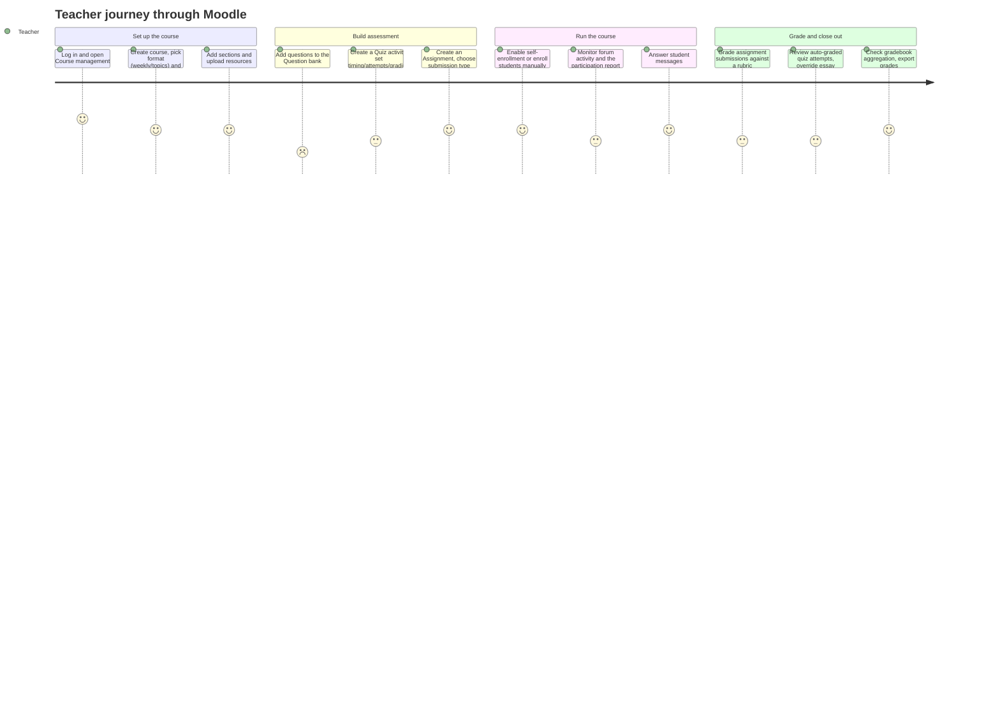

# Teacher journey through Moodle

Course setup to grading. The score per step (1–5) is a rough happiness
read on that step in stock Moodle — low scores mark real, well-known
friction points, not filler.

## Reading the low points

- **Question bank (2):** the single most-cited Moodle pain point — a
  separate authoring surface from the quiz itself, with a UI that hasn't
  changed much in a decade. Educa's whole pitch (the agent drafts
  `QuizItem`s from the lesson content, teacher approves) is a direct
  answer to this step, not a parallel feature.
- **Quiz settings (3):** grading method (highest/average/first/last
  attempt), attempt limits, and review-options timing are all one long
  settings form. Educa's `QuizAttempt` has no "grading method" concept
  yet — it assumes one attempt, scored once.
- **Participation report (3):** teachers lean on this because a course
  page alone doesn't show who's behind. Educa has no analogue — no
  reporting surface exists once a lesson is published.
